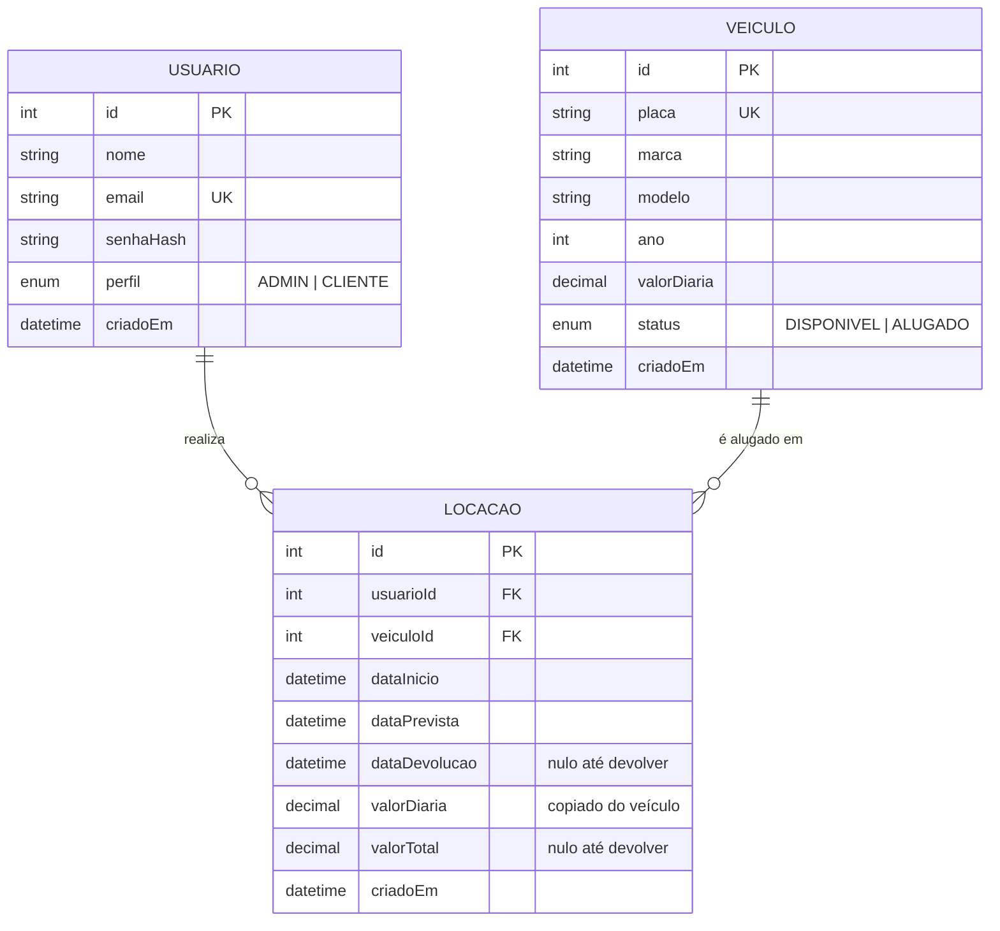

# Diagramas de apoio

Estes diagramas servem de base para a entrega manuscrita (2 diagramas em folha A4 branca). Os blocos em Mermaid são renderizados pelo GitHub; abaixo de cada um há instruções de como desenhar à mão.

## 1. Diagrama Entidade-Relacionamento (modelo de dados)



### Como desenhar à mão

1. Desenhe três retângulos: **USUARIO** à esquerda, **LOCACAO** no centro e **VEICULO** à direita.
2. Dentro de cada retângulo, liste os atributos acima. Sublinhe a chave primária (`id`) e marque as chaves estrangeiras de LOCACAO (`usuarioId`, `veiculoId`) com "FK".
3. Ligue USUARIO a LOCACAO com uma linha e escreva a cardinalidade **1 : N** (um usuário realiza várias locações).
4. Ligue VEICULO a LOCACAO com uma linha e escreva **1 : N** (um veículo participa de várias locações ao longo do tempo).
5. Se usar a notação "pé de galinha", o lado N fica em LOCACAO.

## 2. Diagrama de sequência: locação e devolução

```mermaid
sequenceDiagram
    actor Cliente
    participant Front as Frontend (React)
    participant API as API (Express)
    participant Auth as Middleware autenticar
    participant Serv as locacoesService
    participant BD as MySQL (Prisma)

    Cliente->>Front: clica em "Alugar" e informa data prevista
    Front->>API: POST /locacoes {veiculoId, dataPrevista} + Bearer token
    API->>Auth: valida JWT
    Auth-->>API: req.usuario = {id, perfil}
    API->>Serv: criar(usuario, dados)
    Serv->>BD: busca veículo por id
    BD-->>Serv: veículo (ou nulo → 404)
    Serv->>BD: TRANSAÇÃO: UPDATE veiculo SET status=ALUGADO WHERE id=? AND status=DISPONIVEL
    BD-->>Serv: linhas afetadas (0 → 409 "Veículo indisponível")
    Serv->>BD: INSERT locacao (usuarioId, veiculoId, dataPrevista, valorDiaria)
    BD-->>Serv: locação criada
    Serv-->>API: locação serializada
    API-->>Front: 201 {locacao}
    Front-->>Cliente: redireciona para "Minhas locações"

    Cliente->>Front: clica em "Devolver"
    Front->>API: POST /locacoes/:id/devolucao + Bearer token
    API->>Auth: valida JWT
    API->>Serv: devolver(usuario, id)
    Serv->>BD: busca locação
    BD-->>Serv: locação (404 se não existe, 403 se de outro cliente, 409 se já devolvida)
    Serv->>Serv: valorTotal = dias(início, agora) × valorDiaria
    Serv->>BD: TRANSAÇÃO: UPDATE locacao SET dataDevolucao, valorTotal; UPDATE veiculo SET status=DISPONIVEL
    BD-->>Serv: ok
    Serv-->>API: locação devolvida
    API-->>Front: 200 {locacao com valorTotal}
    Front-->>Cliente: mostra "Veículo devolvido. Valor total: R$ ..."
```

### Como desenhar à mão

1. Desenhe, no topo da folha, de esquerda para direita, as colunas: **Cliente**, **Frontend**, **API**, **Middleware JWT**, **Service**, **Banco**. Trace uma linha vertical tracejada abaixo de cada um (linha de vida).
2. Desenhe as setas horizontais de cima para baixo na ordem acima. Setas cheias para chamadas, setas tracejadas para respostas.
3. Marque com um retângulo os dois blocos de **transação** no banco (reservar o veículo + inserir locação; registrar devolução + liberar veículo).
4. Anote ao lado das respostas os códigos de erro possíveis (401, 403, 404, 409).
5. Pode dividir em duas folhas se preferir: uma para a locação e outra para a devolução.

## Dica para as questões manuscritas

Pontos do código que costumam ser perguntados:

- **Por que `updateMany` com `status: DISPONIVEL` no WHERE?** Garante que dois clientes não aluguem o mesmo veículo ao mesmo tempo: só uma das atualizações afeta uma linha, a outra recebe `count = 0` e vira 409.
- **Por que copiar `valorDiaria` para a locação?** Se o admin alterar a diária do veículo depois, a locação antiga mantém o valor combinado.
- **Como o JWT é validado?** O middleware `autenticar` lê o header `Authorization: Bearer`, chama `jwt.verify` com o segredo do `.env` e coloca `{ id, perfil }` em `req.usuario`.
- **Como o primeiro usuário vira ADMIN?** O service de registro conta os usuários; se for zero, cria com perfil ADMIN.
- **Por que `bcrypt`?** A senha nunca é guardada em texto; guarda-se um hash com salt, e o login compara com `bcrypt.compare`.
