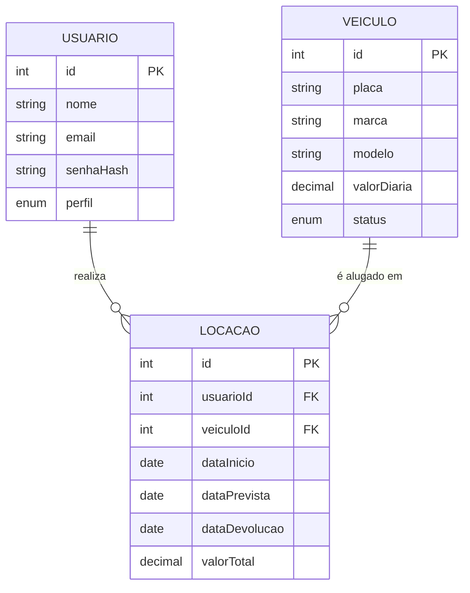
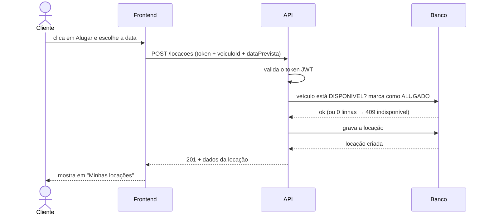

# Diagramas de apoio

Base para a entrega manuscrita (2 diagramas em folha A4 branca). Cada diagrama cabe em uma folha. Os blocos em Mermaid são renderizados pelo GitHub; abaixo de cada um há o passo a passo para desenhar à mão.

## 1. Diagrama Entidade-Relacionamento

### Como desenhar à mão

1. Três retângulos: **USUARIO** à esquerda, **LOCACAO** no meio, **VEICULO** à direita.
2. Dentro de cada um, só os atributos acima (5 a 7 por caixa). Sublinhe o `id` (chave primária) e escreva "FK" ao lado de `usuarioId` e `veiculoId`.
3. Uma linha de USUARIO até LOCACAO com **1** do lado do usuário e **N** do lado da locação.
4. Uma linha de VEICULO até LOCACAO com **1** do lado do veículo e **N** do lado da locação.
5. Pode escrever "realiza" e "é alugado em" sobre as linhas.

## 2. Diagrama de sequência: alugar um veículo

### Como desenhar à mão

1. No topo, quatro caixas lado a lado: **Cliente**, **Frontend**, **API**, **Banco**. Abaixo de cada uma, uma linha vertical tracejada.
2. Nove setas, de cima para baixo, na ordem acima. Seta cheia para pedido, seta tracejada para resposta.
3. A seta 3 ("valida o token JWT") sai e volta para a própria coluna da API.
4. Desenhe um retângulo em volta das setas 4 a 7 e escreva **transação** ao lado: ou tudo acontece, ou nada.
5. Ao lado da seta 5, anote "409 se já estava alugado".

Se preferir desenhar a **devolução** em vez da locação, são as mesmas quatro colunas: Cliente clica em Devolver → Front faz `POST /locacoes/:id/devolucao` → API valida token, confere se a locação é do cliente e se ainda não foi devolvida → Banco grava `dataDevolucao` e `valorTotal` e volta o veículo para DISPONIVEL → API responde 200 com o total → Front mostra "Veículo devolvido. Valor total: R$ ...".

## Dica para as questões manuscritas

Pontos do código que costumam ser perguntados:

- **Por que `updateMany` com `status: DISPONIVEL` no WHERE?** Garante que dois clientes não aluguem o mesmo veículo ao mesmo tempo: só uma das atualizações afeta uma linha, a outra recebe `count = 0` e vira 409.
- **Por que copiar `valorDiaria` para a locação?** Se o admin alterar a diária do veículo depois, a locação antiga mantém o valor combinado.
- **Como o JWT é validado?** O middleware `autenticar` lê o header `Authorization: Bearer`, chama `jwt.verify` com o segredo do `.env` e coloca `{ id, perfil }` em `req.usuario`.
- **Como o primeiro usuário vira ADMIN?** O service de registro conta os usuários; se for zero, cria com perfil ADMIN.
- **Por que `bcrypt`?** A senha nunca é guardada em texto; guarda-se um hash com salt, e o login compara com `bcrypt.compare`.
- **Como o valor total é calculado?** `calcularDias` arredonda para cima os dias entre início e devolução, com mínimo de 1, e multiplica pela diária.
